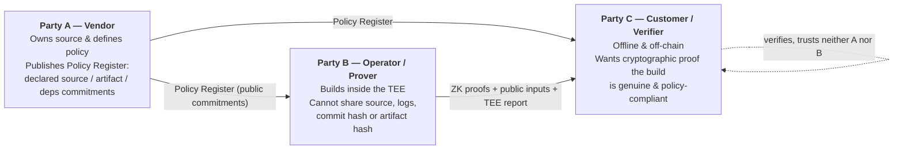
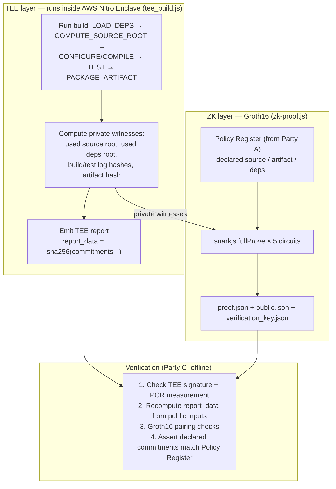
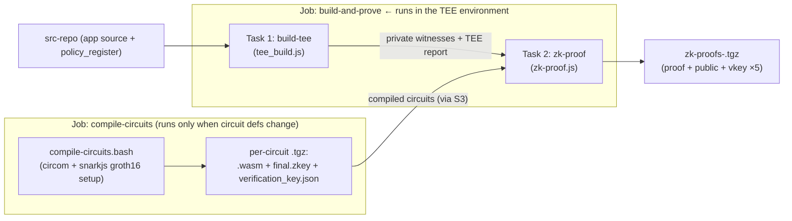

# Zero-Knowledge Build Verification (Hybrid TEE–ZK)

Reference implementation for the paper *"Zero-Knowledge Build Verification for
Sovereign & Private Builds via a Hybrid TEE-ZK Architecture."*

This project lets a build operator **prove that a software build complied with a
vendor's policy** — correct source, approved dependencies, successful
build/test stages, and the expected artifact — **without revealing** the source
code, dependency list, build/test logs, or artifact hashes to the verifier.

It does this by combining two layers:

- **A Trusted Execution Environment (TEE)** runs the real build and produces
  private measurements (witnesses) plus a hardware attestation report.
- **A Zero-Knowledge layer** (Groth16 zk-SNARKs, Circom + SnarkJS) proves those
  private measurements satisfy the vendor's published policy commitments.

The reference workload is **`demo-hasher`**, a C++17 / CMake / vcpkg application.
The measured overhead of adding privacy to the build is ~**1.81×**.

> **Prototype note on the TEE.** The architecture targets an **AWS Nitro
> Enclave** for hardware-isolated execution and remote attestation. In this
> prototype, `tee_build.js` runs the build and computes real witnesses, but
> emits a **placeholder attestation report** (`tee_report.json` with a
> hardcoded `measurement` and dummy `nonce`/`signature`/`certificate_chain`).
> Wiring the Nitro NSM (COSE_Sign1 document, PCR measurements, CA bundle) is the
> remaining integration step; the `report_data` field is already computed for
> real from the public commitments.

---

## The trust model (A–B–C)



Party B works in a sovereign / air-gapped environment and legally **cannot**
disclose raw build data. Party C still gets two linked guarantees: the **TEE**
proves the measurements came from a genuine isolated build; the **ZK proofs**
prove those measurements comply with Party A's policy.

---

## System architecture



---

## What's in `zk/` — the five circuits

The ZK layer is five Circom circuits (`circom 2.2.3`, `snarkjs 0.7.6`,
`circomlib` Poseidon). Each circuit directory holds its own `circuits/`,
`scripts/generate_input.js`, `package.json`, and (after compilation)
`build/`, `keys/`, and `proofs/`. They fall into three functional types:
**equality commitments**, **membership proofs**, and **preimage checks**.

| Circuit | Dir | Type | Proves | Public inputs |
|---|---|---|---|---|
| **f_source** | [zk/f_source](zk/f_source/circuits/f_source.circom) | Equality commitment | Used source root == declared source root (both opened from Poseidon commitments) | `declared_commitment`, `used_commitment` |
| **f_artifact** | [zk/f_artifact](zk/f_artifact/circuits/f_artifact.circom) | Equality commitment | Built artifact hash == declared artifact hash | `declared_commitment`, `used_commitment` |
| **f_build** | [zk/f_build](zk/f_build/circuits/f_build.circom) | Preimage check | Private build-log chunks Poseidon-chain to the public hash **and** all stage exit codes == 0 | `build_log_hash` |
| **f_test** | [zk/f_test](zk/f_test/circuits/f_test.circom) | Preimage check | Private test-log chunks Poseidon-chain to the public hash **and** all stage exit codes == 0 | `test_log_hash` |
| **f_deps_membership** | [zk/f_deps_membership](zk/f_deps_membership/circuits/F_deps_membership.circom) | Membership proof | Every used dependency is a member of the vendor's approved-dependency Merkle tree | `approved_deps_commitment`, `used_deps_commitment` |

Details worth knowing:

- **f_source / f_artifact** each check two Poseidon commitment openings
  `C = Poseidon(root, r)` and then assert the two underlying roots are equal.
  The roots and blinding factors `r1, r2` stay private.
- **f_build / f_test** chain `h0 = Poseidon(chunk₁, chunk₂)`,
  `hᵢ = Poseidon(hᵢ₋₁, chunkᵢ₊₂)`, then
  `final = Poseidon(h_last, exit₁, exit₂, exit₃)`. Fixed at **16 log chunks**
  (`FBuild(16)` / `FTest(16)`), 31 bytes per chunk, 3 stage exit codes forced to 0.
- **f_deps_membership** supports up to **8 dependencies** against a fixed
  depth-3 approved Merkle tree. It is split across three files:
  [F_deps_membership.circom](zk/f_deps_membership/circuits/F_deps_membership.circom)
  (top level, commitment openings, enabled-slot masking),
  [merkle_membership.circom](zk/f_deps_membership/circuits/merkle_membership.circom)
  (masked Merkle path verification per leaf), and
  [used_deps_root.circom](zk/f_deps_membership/circuits/used_deps_root.circom)
  (recomputes the used-deps root over the padded 8-leaf tree). Each leaf is
  `Poseidon(encode(name), encode(version))`.

`zk/ptau_keys/` holds the committed, pre-computed Powers-of-Tau files reused at
compile time: `pot12` (f_source, f_artifact), `pot14` (f_build, f_test), and
`pot16` (f_deps_membership).

---

## What's in `ci/` — the pipeline

A [Concourse](https://concourse-ci.org/) pipeline ([ci/pipeline.yaml](ci/pipeline.yaml))
with two jobs, backed by two container images and three CI scripts.



### Job 1 — `compile-circuits`

Runs [ci/compile-circuits.bash](ci/compile-circuits.bash) inside the **ZK
toolchain image** ([ci/Dockerfile.zk](ci/Dockerfile.zk): Node 22 + Rust-built
`circom 2.2.3` + `snarkjs 0.7.6`). For each of the five circuits it compiles
`circom → r1cs/wasm`, runs the Groth16 trusted setup against the shared ptau
file, contributes entropy, exports the verification key, and bundles
`.wasm + final.zkey + verification_key.json` into a per-circuit `.tgz` pushed to
S3/MinIO. This is amortized — it only re-runs when a circuit definition changes.

### Job 2 — `build-and-prove` *(the TEE job)*

Two sequential tasks. **Both run inside the TEE environment (AWS Nitro Enclave);**
`build-tee` performs the measured build and `zk-proof` consumes its private
witnesses.

1. **`build-tee`** — [ci/scripts/tee_build.js](ci/scripts/tee_build.js), run in
   the **TEE build image** ([ci/Dockerfile.tee](ci/Dockerfile.tee): Node 22 +
   build-essential + CMake + Ninja + vcpkg pinned to a baseline commit, with
   `fmt`, `nlohmann-json`, `openssl`, `catch2` pre-installed for offline builds).
   It mirrors the native build (`LOAD_DEPS → COMPUTE_SOURCE_ROOT →
   CONFIGURE/COMPILE_BUILD → TEST → PACKAGE_ARTIFACT`) and, during the build,
   computes the private witnesses for all five circuits:
   - `used_source_root` + Poseidon commitment,
   - used-dependency leaves, Merkle root, and commitment,
   - chained Poseidon hashes of the build and test logs (with stage exit codes),
   - the packaged `demo-hasher` artifact hash + commitment.

   It writes `pvt-witness/*.json`, `build_log.json`,
   `final_build_summary.json`, the artifact tarball, and `tee_report.json`
   (whose `report_data = sha256(used_source_commitment | used_deps_commitment |
   build_log_hash | test_log_hash | built_artifact_commitment)`). *(As noted
   above, the attestation envelope around `report_data` is a placeholder in this
   prototype.)*

2. **`zk-proof`** — [ci/scripts/zk-proof.js](ci/scripts/zk-proof.js), run in the
   ZK toolchain image. It extracts the five compiled circuit bundles, loads the
   private witnesses from `build-tee`, loads the **declared commitments** from
   `src-repo/policy_register/` (`declared_source.json`,
   `declared_artifact.json`, `declared_deps.json`), assembles each circuit's
   input, runs `snarkjs.groth16.fullProve`, verifies each proof locally, and
   bundles `proof.json + public.json + verification_key.json` per circuit into
   `zk-proofs-<build>.tgz`.

Other `ci/` files: [ci/creds.yaml](ci/creds.yaml) supplies pipeline parameters
(repo URIs/keys, S3/MinIO endpoint and credentials, image repository/tag), and
[ci/scripts/package.json](ci/scripts/package.json) declares the Node deps
(`circomlibjs`, `snarkjs`) installed before each task.

---

## What `docker-compose.yaml` spins up

[docker-compose.yaml](docker-compose.yaml) brings up the **local CI
infrastructure** so you can run the pipeline on your machine:

| Service | Image | Purpose | Port(s) |
|---|---|---|---|
| `concourse-db` | `postgres` | Backing database for Concourse | internal |
| `concourse` | `concourse/concourse` (`quickstart`, privileged) | The CI server + worker that runs the pipeline. Local login `test:test` | `8080` (web UI) |
| `minio` | `minio/minio` | S3-compatible object store for compiled circuits, witnesses, proofs, and the artifact | `9000` (S3 API), `9001` (console) |
| `minio-bootstrap` | `minio/mc` | One-shot: waits for MinIO and creates the `zk-circuits` bucket, then exits | — |
| `registry` | `registry:2` | Local Docker registry the Concourse worker pulls the TEE/ZK images from | `5000` |

> The Concourse worker's containerd uses `8.8.8.8` DNS and can't resolve compose
> service names or `localhost`, so when building/pushing the images and setting
> `creds.yaml`, point the registry at your host's **LAN IP** (`<LAN-IP>:5000`),
> not `localhost:5000`.

---

## Repository layout

```
.
├── docker-compose.yaml          # local Concourse + MinIO + registry
├── ci/
│   ├── pipeline.yaml            # Concourse pipeline (2 jobs)
│   ├── compile-circuits.bash    # Job 1: compile + Groth16 setup for 5 circuits
│   ├── creds.yaml               # pipeline parameters (repos, S3, images)
│   ├── Dockerfile.zk            # circom + snarkjs toolchain image
│   ├── Dockerfile.tee           # TEE build image (CMake + vcpkg + Node)
│   └── scripts/
│       ├── tee_build.js         # Task 1: build + witness + TEE report  (TEE)
│       ├── zk-proof.js          # Task 2: Groth16 proof generation      (TEE)
│       └── package.json
└── zk/
    ├── f_source/                # source identity (equality commitment)
    ├── f_artifact/              # artifact binding (equality commitment)
    ├── f_build/                 # build-log preimage + exit codes
    ├── f_test/                  # test-log preimage + exit codes
    ├── f_deps_membership/       # dependency Merkle membership (≤8 deps)
    └── ptau_keys/               # shared pot12 / pot14 / pot16 ptau files
```

---

## Known limitations

- **Fixed circuit bounds:** `f_deps_membership` caps at 8 dependencies;
  `f_build` / `f_test` cap at 16 log chunks. Larger inputs require recompiling
  the circuits. (The paper's future work discusses Nova-style IVC folding to
  remove the hard limit.)
- **TEE attestation is simulated** in the current prototype (see the note at the
  top); real Nitro NSM integration is pending.
- **Source-provenance (VCS) controls** — branch protection, source history — are
  outside the current ZK circuits.
